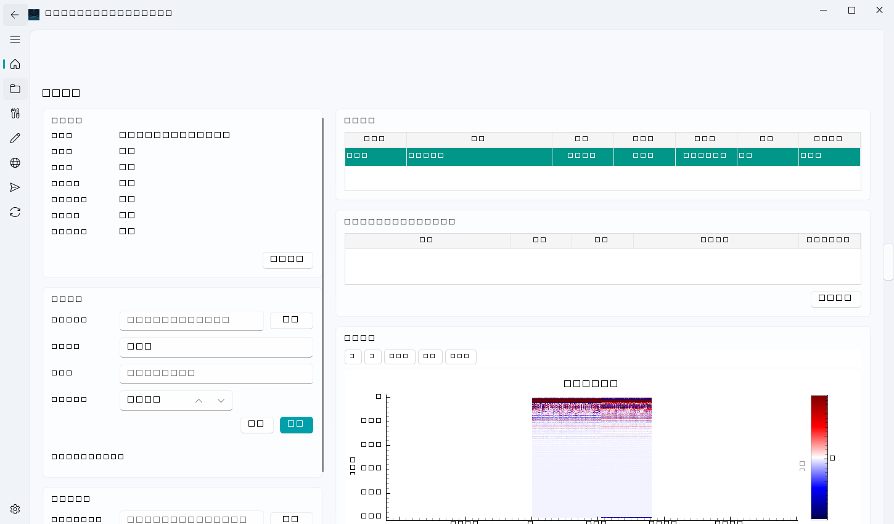

# 导入测线数据

## 通用流程

项目页 → **导入测线** → 选文件 → 预检确认格式与规模 → **导入**。取消或写入失败由导入事务回滚，失败原因见任务和日志。

## 可直接导入的格式

| 格式 | 伴随文件 | 注意事项 |
| --- | --- | --- |
| CSV / TXT | 无 | 二维矩阵，或有头信息的无人机堆叠 CSV |
| NPY / NPZ | 无 | 必须是二维 B-scan 矩阵 |
| H5 / HDF5 | 无 | CDUT 采集格式或通用二维矩阵；采集格式按声明转换方向与时间轴 |

RD3/RD7、DT1、DZT、SEG-Y、ENVI、ImpulseRadar 已有底层读取器，但尚未接通项目导入向导；需先转换为上述格式，并保留原始时窗、轴方向和测距信息。gprMax `.out` 也需单独转换。完整范围见[数据格式参考](../reference/数据格式参考.md)。

## CDUT 采集 HDF5

直接选择 `lineData_streaming.h5`，采集结束后再导入；不需要改名或转 CSV。预检显示采样点×道数、时窗与实部/幅值分量。定位或高度为 NaN 时仍保留雷达道；缺少定位会限制空间成果生成。文件没有道间距时需另行提供真实测线尺度。

## 无人机 CSV 与轨迹

堆叠 CSV 可提供经纬度和高度列。若另持 RTK/IMU/高度计设备文件，可在导入后进行[传感器同步](传感器同步.md)。

## 导入失败排查

| 报错 | 处置 |
| --- | --- |
| 文件截断 / 数据不足 | 核对头信息声明的采样点、道数与实际数据 |
| 无法解析数值 / 非二维矩阵 | 核对导出格式和矩阵布局 |
| 已识别格式但未直接解码 | 该格式尚未接通向导，先转换后导入 |
| HDF5 样本数或逐道元数据长度不一致 | 检查采集文件是否已完成写入、属性和数组是否一致 |
| 磁盘不足 | 释放目标项目盘空间后重试，并检查项目完整性 |
