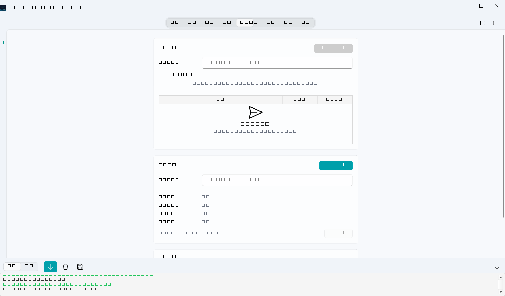

# 生成报告与备份



## 报告包

成果页 → **生成报告包**，在应用内选择测线、处理成果、空间成果版本和报告章节，填写标题、编制/审核/批准及钻孔误差阈值。包名可留空自动命名。历史报告可从下拉列表重新打开，输出目录按报告所属项目解析。

空间成果右键可设为当前版本、打开成果目录、移入回收站，或导出 ZIP、GeoJSON、CSV、KML、GPKG、SHP。空间页的“界面深度网格”可设置格网尺寸；它表示界面控制点的单元格均值，不是雷达振幅 C-scan。

包名填写单个名称，可含中文和空格；不要填写目录或绝对路径。打开目录使用报告所属项目位置。

- PDF / HTML / Excel 三格式报告
- 工程图件（含 GIS 平面图渲染）
- 可追溯 CSV/JSON 数据表
- 文件审计与 SHA-256 校验和清单

报告内容按 profile 分节（可开关：界面标注、空间分析、钻孔对比等节）。生成走后台任务，任务页看进度。

## 逐步处理结果 ZIP

项目资源树中，右键测线 → **打包处理结果…**；右键某个处理成果 → **打包到此步的结果…**。
在系统“另存为”中选择位置，默认文件名为 `L01_处理结果.zip`。任务页可查看进度或取消。

- 测线入口包含这条测线所有已保存的处理结果（含分支）；成果入口只包含所选结果及其已确认的前序成果。
- 两个入口都附带一份 `raw/data.h5`：打包时工程中未处理的测线矩阵及其坐标轴，可重新导入。`raw/source.json` 记录来源元数据；每包只放一份，不随处理步数重复。
- 这份原始输入是工程中的数据快照，不是原始采集 CSV/H5 文件的逐字节副本。若工程曾替换原始输入，不能据此认定它与每份历史成果的输入相同；原始数据不可读取时，任务报错，不生成缺少原始数据的新包。
- 每步目录包含完整矩阵 `data.h5`、B-scan 预览 `bscan.png` 和 `parameters.json`。`manifest.json` 记录原始输入、顺序、分支、来源和缺失说明，`checksums.json` 校验原始输入及各步结果的 SHA-256。
- H5 保留保存结果的距离、时间、深度轴，可在包含本功能的 MyGPR 中重新导入。PNG 为有限分辨率预览，完整数值以 H5 为准。
- 仅导出实际保存的数据。旧成果的来源不明、前序成果被移除或某次运行只保存最终结果时，会在清单中说明，不重新运行算法补齐。
- 未持久化逐步传感器快照的成果，不会附上可能已失去对应关系的原始传感器数组。
- 如果替换过原始测线，且历史成果只保存了轴的形状描述、没有完整坐标快照，软件会拒绝借用新测线的轴来读取或打包旧成果。请恢复生成该成果时的项目备份，或根据当前输入重新处理；不会静默缩放旧成果的位置。
- 完成压缩和校验后才发布 ZIP；取消或失败不保留半成品。同名文件保留，新文件自动增加编号。

这是单条测线的结果交付包。需要恢复整个项目时，仍使用下面的项目备份。

## 项目改名与更换目录

项目页右上角 **⋯ → 重命名项目…** 修改显示名称。测线列表或项目资源树右键
**重命名测线…**，也可选中单条测线后按 **F2**。名称长度为 1–80 个字符；项目/测线编号、
磁盘文件名和已有成果保持不变。只读项目或任务进行中不能改名或迁移。

项目页 **⋯ → 迁移项目目录…**，填写尚不存在的新项目目录，也可用“浏览…”选择父目录。
软件复制项目内测线、处理成果、标注和附件，逐文件校验并检查项目完整性，成功后自动打开
新位置、更新最近与固定项目路径。旧目录保留；这是一次复制后切换，后续修改只写入当前打开的位置。

- 支持跨盘迁移，需要目标磁盘有足够空间。已有目标目录、项目自身及其上下级目录均不接受。
- 项目和目标路径中的符号链接/目录联接、尚未收纳到项目内的外部数据引用会阻止迁移；先将依赖收纳并确认项目可正常读取。
- 复制期间不要用其他程序修改项目。可以取消；失败或取消时保持原项目可用，不覆盖已有目标目录。
- 校验完成后，若最终打开新副本失败，可能保留该已验证副本供检查，当前仍保留原位置。迁移不代替独立介质备份。

## 备份

### 图形界面

成果页 → **备份当前项目**：

- **增量备份**（默认勾选）：只打包相对同目录最近一次备份变化的文件，并记录删除；恢复时重放完整基准链。
- **保留最近 N 个恢复点**：默认 10。必需的祖先档案也会保留，因此 ZIP 文件数量可能超过 N。

### 无界面

```python
backend.submit_project_backup(project_id, destination_dir, incremental=True, retention_keep=10)
```

### 规则

- 备份是带 SHA-256 清单的压缩包，发布前实际恢复到临时目录校验；需要完整项目展开空间及额外预留空间。
- 正式灾难恢复请选择独立外部介质；当前图形界面不会核验物理磁盘独立性。
- 增量恢复需要基准链完整：同目录的基准档案不可删除（删除后恢复报"缺少基准档案"）。
- 项目内符号链接会使备份被拒绝；临时文件（`.transactions`/WAL/锁文件）自动排除。
- 压缩、校验及恢复验证支持协作取消；在发布前取消，不产生新的正式档案或清理旧备份。

本维护工作区创建 **v2 备份清单**，继续兼容旧 v1 档案。新档应使用包含本轮维护的版本或更新版本恢复；
已发布 v0.11.0 的旧恢复器会拒绝 v2，避免忽略删除记录后恢复出错误内容。旧档案不会被自动改写。

## 恢复

成果页 → **从备份恢复** → 选归档和目标父目录 → 可填新项目目录名 → 恢复为**新项目**（不覆盖当前项目）。恢复完成后自动做只读完整性验证。

## 建议

- 每个关键节点（导入后、标注确认后、交付前）各做一次备份；日常用增量，里程碑用全量。
- 正式交付前把备份拷贝到与工作机不同的物理设备。
